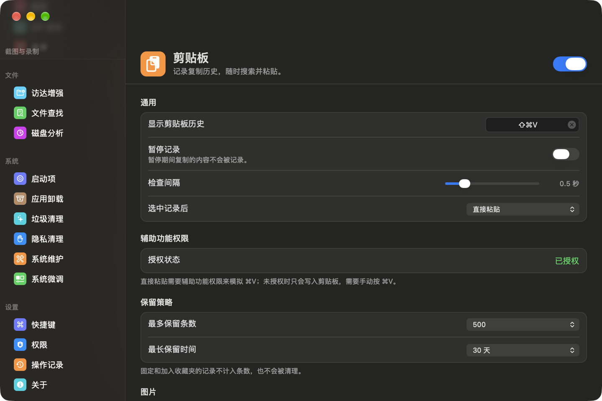
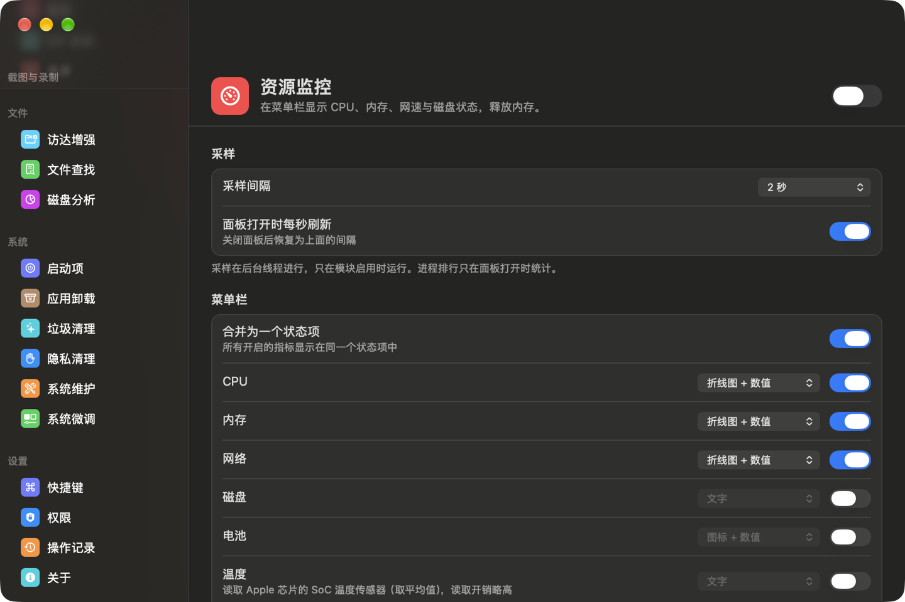
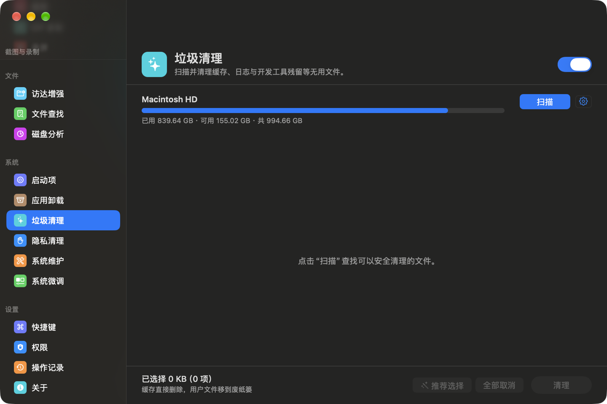
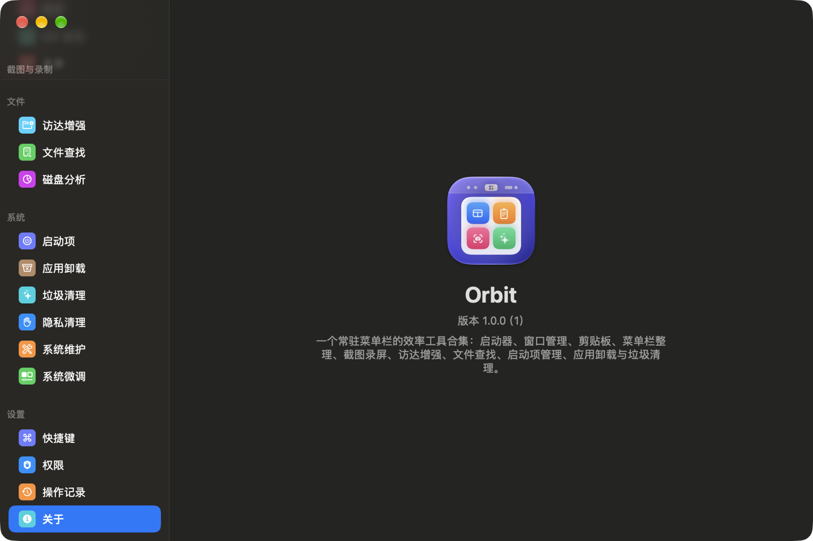

  

<h1 align="center">Orbit</h1>

  常驻菜单栏的 macOS 效率工具合集：用一个轻量进程，替代启动器、窗口管理、剪贴板、菜单栏整理、截图录屏、访达增强、文件查找、启动项管理、应用卸载与垃圾清理等十几款软件。

  <a href="https://wangwanjie.github.io/Orbit/">主页</a> ·
  <a href="https://github.com/wangwanjie/Orbit/releases/latest">下载</a> ·
  <a href="https://github.com/wangwanjie/Orbit/issues">反馈</a>

## 下载

Orbit 为 Apple 芯片和 Intel 芯片分别提供安装包，需要 **macOS 13.0 或更高版本**：

| 芯片 | 下载最新版 |
| --- | --- |
| Apple 芯片（M1 及更新） | [Orbit-arm64.dmg](https://github.com/wangwanjie/Orbit/releases/latest/download/Orbit-arm64.dmg) |
| Intel 芯片 | [Orbit-x86_64.dmg](https://github.com/wangwanjie/Orbit/releases/latest/download/Orbit-x86_64.dmg) |

不确定是哪种芯片时，打开「苹果菜单 › 关于本机」，看「芯片」或「处理器」一栏。历史版本见 [Releases](https://github.com/wangwanjie/Orbit/releases)。

安装包已经过 Apple 公证。打开 DMG，把 Orbit 拖进「应用程序」文件夹，再从「应用程序」中打开即可。Orbit 内置自动更新（Sparkle），默认每天检查一次，只会下载与本机芯片匹配的版本；也可以在菜单栏图标的菜单或「控制中心 › 通用 › 更新」中手动检查。

## 功能

每个功能都是可以单独启停的模块：停用的模块不注册快捷键，也不运行任何后台任务。

| 模块 | 对标 | 主要能力 | 默认快捷键 |
| --- | --- | --- | --- |
| 启动器 | Sol / Alfred | 应用（支持拼音与首字母）、系统设置、计算器、网页搜索、网址、文件、系统命令、自定义快捷链接、脚本命令（兼容 Sol 脚本）、结束进程、内置编解码 / 二维码 / 翻译工具；任意命令可绑定快捷键；可从 Sol 导入配置 | ⌥Space |
| 窗口管理 | Rectangle / Magnet | 半屏、四分之一、三分之一、三分之二、最大化、居中、恢复、跨显示器等 26 个动作，重复按键循环尺寸，拖到屏幕边缘吸附，窗口间距 | ⌃⌥ + 方向键等 |
| 剪贴板 | Paste / Maccy | 记录文本、富文本、图片、文件、链接、颜色；底部卡片面板，搜索、筛选、收藏夹、固定；直接粘贴或粘贴为纯文本；忽略密码管理器 | ⇧⌘V |
| 菜单栏 | Bartender / Ice | 为每个图标选择“始终显示 / 隐藏 / 始终隐藏”，自动重新隐藏，悬停或点击展开；macOS 27 使用系统原生隐藏 | 自定义 |
| 资源监控 | iStat Menus / Stats | 菜单栏显示 CPU、内存、网速、磁盘、电池，详情面板含趋势图与进程排行 | — |
| 截图 | iShot | 区域 / 窗口 / 全屏 / 延时截图，放大镜取色，箭头、画笔、文字、马赛克、模糊、序号等标注，贴图，文字识别 | ⌃⇧A 区域 |
| GIF 录制 | LiceCap | 选择区域录制为 GIF，帧率与缩放可调 | ⌃⇧G |
| 录屏 | — | 区域 / 窗口 / 全屏录制为 MP4 或 MOV，系统声音与麦克风，显示鼠标点击 | ⌃⇧R |
| 访达增强 | iRightMouse | 右键菜单：在终端或编辑器中打开、拷贝路径、新建文件（含 Office 模板）、剪切粘贴、显示隐藏文件、计算哈希、压缩、图片格式转换 | 自定义 |
| OpenIn 小程序 | OpenInTerminal-Lite | 拖到访达工具栏，一键在终端或编辑器中打开当前目录 | — |
| 文件查找 | Find Any File | 不建索引的实时搜索：组合条件、内容搜索、卷目录搜索、列表 / 树形 / 网格结果 | 自定义 |
| 磁盘分析 | DaisyDisk | 矩形树图与旭日图可视化磁盘占用并逐层下钻；重复文件查找 | — |
| 启动项 | — | 按应用聚合查看登录项、LaunchAgents、LaunchDaemons、后台项目；启停、删除、清理失效项 | — |
| 应用卸载 | AppCleaner | 应用列表与大小，按 bundle id / 开发者匹配残留文件，个人数据默认保留，批量卸载，孤立残留扫描，拖入即卸载 | — |
| 垃圾清理 | CleanMyMac | 120 条规则，风险分级与推荐选择：缓存、日志、Xcode 与开发工具、浏览器、项目编译产物、本地 AI 模型、旧安装包、大文件等 | — |
| 隐私清理 | — | Safari、Chromium 系、Firefox 的历史、下载、Cookie、站点数据，最近使用项目、剪贴板 | — |
| 系统维护 | — | 刷新 DNS、重建 Spotlight 索引与 LaunchServices、重置 Quick Look 与图标缓存、重启访达 / 程序坞 / 音频、释放内存、校验启动卷 | — |
| 系统微调 | — | 54 项访达、程序坞、截屏、键盘等隐藏设置，修改后回读确认，可恢复默认 | — |

所有快捷键都可以在控制中心的“快捷键”页修改。清理、卸载、启动项等破坏性操作的结果统一记录在“操作记录”页。设置可以导出为 `.orbitconfig` 文件，在另一台 Mac 上双击即可还原。

界面支持**简体中文、繁體中文、English**，可以在「控制中心 › 通用 › 语言」中随时切换，无需重启；外观可选浅色、深色或跟随系统。

## 截图

| 剪贴板 | 资源监控 |
| --- | --- |
|  |  |

| 垃圾清理 | 关于 |
| --- | --- |
|  |  |

## 权限

首次使用相关功能时 Orbit 会提示授权，也可以在控制中心的“权限”页统一查看：

| 权限 | 用途 |
| --- | --- |
| 辅助功能 | 窗口管理、剪贴板直接粘贴、菜单栏图标管理 |
| 屏幕录制 | 截图、GIF 录制、录屏 |
| 完全磁盘访问 | 文件查找、卸载残留扫描、垃圾清理 |
| 自动化：访达 / 系统事件 | 在终端或编辑器中打开、读取访达选中项、登录项管理 |
| 特权辅助程序（可选） | 以 root 搜索受限目录、删除 root 拥有的文件、管理 LaunchDaemons、执行白名单内的系统维护任务 |

访达右键菜单需要在「系统设置 › 通用 › 登录项与扩展 › 访达扩展」中启用 Orbit Finder（访达增强设置页有直达按钮）。

## 常见问题

**打开时提示“无法验证开发者”？** 安装包已经过 Apple 公证，正常不会出现。如果从其他渠道获得安装包，请到本页重新下载。

**授权后功能仍不可用？** 屏幕录制等权限授权后需要重新打开 Orbit。请确认只运行了一份 Orbit，并且它位于「应用程序」文件夹中。

**如何卸载 Orbit？** 先在「控制中心 › 权限」中卸载特权辅助程序（如已安装），退出 Orbit 后把它移到废纸篓即可。

## 反馈

遇到问题或有功能建议，欢迎在 [Issues](https://github.com/wangwanjie/Orbit/issues) 中反馈。本仓库只用于发布安装包与更新信息，不包含源代码。

## 致谢

Orbit 的部分实现移植或参考了以下开源项目，在此致谢：

- 移植代码（MIT 许可）：[Rectangle](https://github.com/rxhanson/Rectangle)、[Maccy](https://github.com/p0deje/Maccy)、[OpenInTerminal](https://github.com/Ji4n1ng/OpenInTerminal)、[Hidden Bar](https://github.com/dwarvesf/hidden)
- 参考思路：[Ice](https://github.com/jordanbaird/Ice)、[Thaw](https://github.com/thaw-app/Thaw)、[RClick](https://github.com/wflixu/RClick)、[Pearcleaner](https://github.com/alienator88/Pearcleaner)、[MangoDisk](https://github.com/harry0703/MangoDisk)
- 使用的开源库：[Sparkle](https://github.com/sparkle-project/Sparkle)、[SnapKit](https://github.com/SnapKit/SnapKit)、[MMKV](https://github.com/Tencent/MMKV)、[GRDB](https://github.com/groue/GRDB.swift)

Copyright © 2026 VanJay. All rights reserved.
